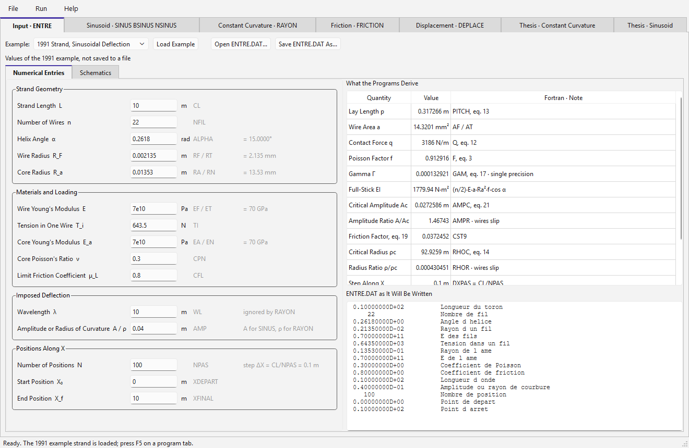
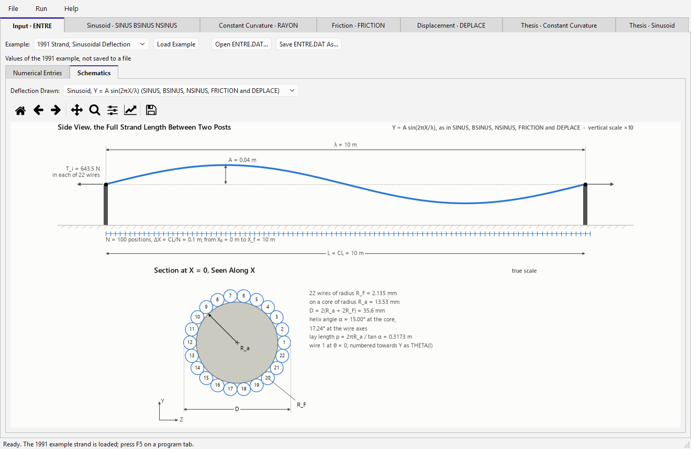
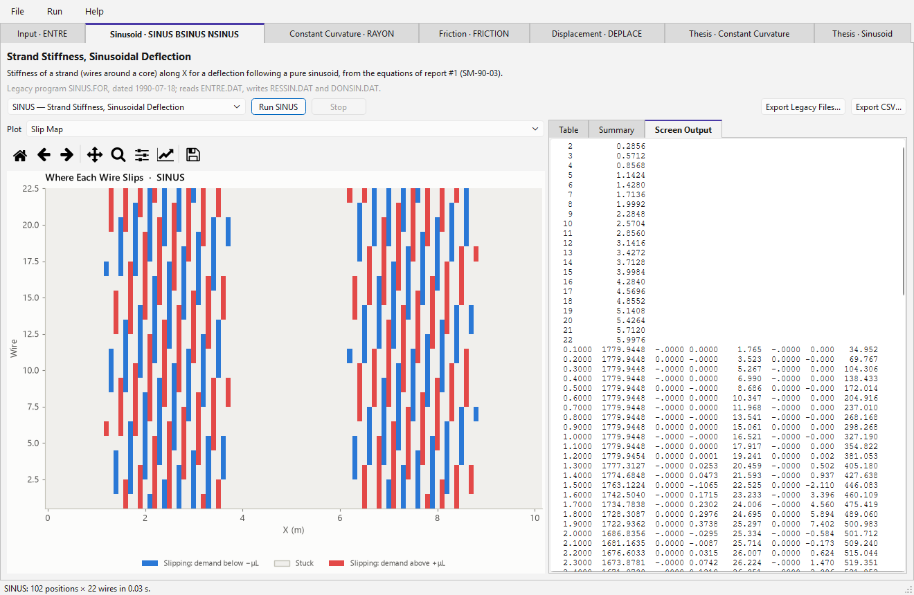
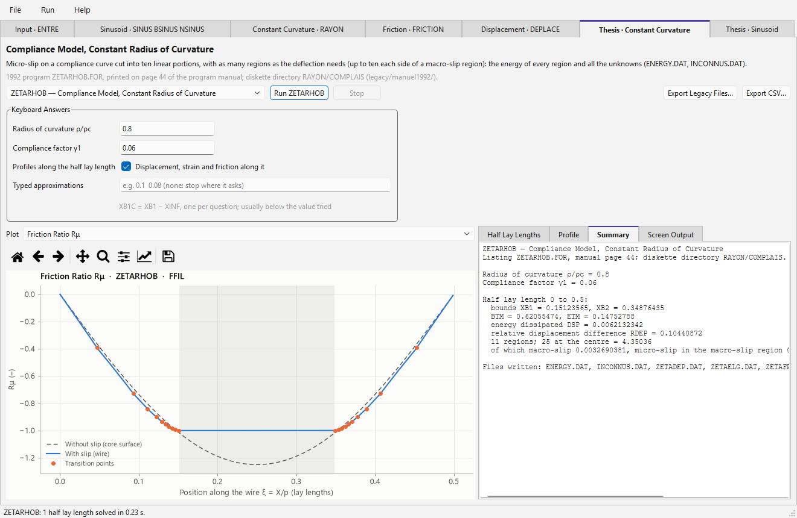
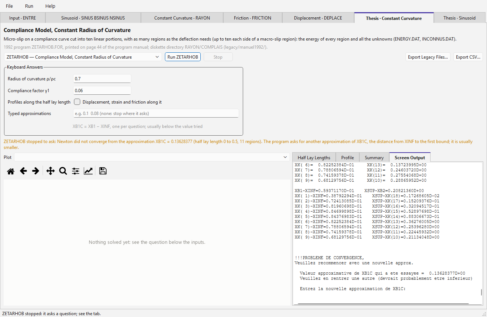

# Strand Slip — user manual

Strand Slip runs the seven Fortran programs of 1990 that computed the transverse stiffness
of a strand — wires wound on a core, sticking to it or slipping — under an imposed deflection,
and the six programs of the 1992 thesis that computed the energy a wire dissipates by slipping
([the thesis tabs](#the-thesis-tabs-1992)). The numbers are the ones the old programs printed;
the plots, tables and file handling are new.

## Getting started

Launch it with `runApp.cmd` (or `strand-slip` in the project's virtual environment). It
opens on the **Input** tab with the strand of the 1991 progress reports already filled in: 22
aluminium wires on a 13.53 mm core, 643.5 N per wire, a sinusoidal deflection of 0.04 m over
10 m. Go to the **Sinusoid** tab and press **Run SINUS** (or F5): at X = 2.5 m you get the
stiffness the 1991 report printed, 1671.24 N·m².

## The tabs

| Tab | Program(s) | Answers |
|---|---|---|
| Input · ENTRE | ENTRE | The fifteen values every program reads |
| Sinusoid | SINUS, BSINUS, NSINUS | Stiffness EI along X for Y = A sin(2πX/λ) |
| Constant Curvature | RAYON | Stiffness EI along X for a constant radius of curvature ρ |
| Friction | FRICTION | Friction each wire needs to stay stuck (equation 19) |
| Displacement | DEPLACE | Displacement of the core surface along each contact helix (equation 23) |
| Thesis · Constant Curvature | HARDRHOB, CONTRHOB, ZETARHOB | One half lay length bent to a constant radius: slip regions, energy dissipated, displacement difference |
| Thesis · Sinusoid | HARDSIN, CONTSIN, ZETASIN | The same along a sinusoid: energy over a wavelength, displacement difference at λ/4, or one half lay length |

The Input tab feeds the 1990 programs only; the thesis tabs have their own answers.

The open tab is the one joined to the page below it: the page's colour, an indigo bar along its
top and its label in bold, where the closed tabs sit back on a darker ground. The tabs inside a
page (Table, Summary, Screen Output...) are marked the same way under a thinner bar. In a window
too narrow for every label, the program tabs' labels end in "…"; widen it to read them whole.

## The Input tab

The tab has two pages: **Numerical Entries**, the form, and **Schematics**, the strand those
values describe ([below](#schematics)). Example, Open and Save stay above both.

The fields are ENTRE.EXE's fifteen questions, in SI units as the programs expected: metres,
pascals, newtons, radians. Hover over a field to read the question ENTRE asked. Next to each
field are its Fortran names (strand programs / cable programs) and a friendlier reading:
0.2618 rad shows as 15.0002°, 7e10 Pa as 70 GPa.

You can type numbers as Fortran accepted them — `7e10`, `0.7D+11` — or with a decimal comma.
A field that is not a number turns red and the programs will not run until it is fixed.
Values a program could not run on (a helix angle in degrees, 51 wires, a zero wavelength) are
explained in red under the form.

**What the Programs Derive** updates as you type: lay length p, contact force q, Gamma, the
critical amplitude Ac and radius ρc, and whether wires will slip (A/Ac above 1, or ρ/ρc below 1).
**ENTRE.DAT as It Will Be Written** shows the file exactly as ENTRE.EXE would have written it.

- **Open ENTRE.DAT…** reads a file the way the programs did: only columns 2–15 count, and a
  number written without a decimal point has its last eight digits read as decimals. Anything
  surprising of that kind is listed in red after opening.
- **Save ENTRE.DAT As…** writes the file the old programs can read, DOS line endings included.
- **Example** loads one of the two cases from the 1991 reports (also under File > Load Example).

Two things the old input file did that still apply:

- **One field, two meanings.** "Amplitude or Radius of Curvature" is the amplitude A for the
  sinusoid programs and the radius ρ for RAYON. RAYON also ignores the wavelength. If you run
  RAYON with an amplitude in that field, the status bar says so.
- **The step along X is CL/NPAS**, the strand length divided by the number of positions — not
  the span from start to end divided by anything. The hint next to Number of Positions shows it.

### Schematics

The second page draws the strand from the values on the first, and redraws when they change:

- **Side view.** The whole strand length L = CL between two posts, under the tension T_i in each
  wire. The deflection is the programs' own: Y = A sin(2πX/λ) for SINUS, BSINUS, NSINUS,
  FRICTION and DEPLACE. For RAYON it is the curvature 1/ρ of Y = −X²/2ρ, drawn as the arc
  through both posts, since only the curvature enters RAYON's equations. A deflection of
  centimetres on a span of metres would be a flat line, so the vertical is drawn taller by the
  round factor given at the top right (×10 for the 1991 strand). Hover over the strand to read
  the true Y at any X. Under the ground are the positions where SINUS and RAYON compute: a tick
  for each, or a band when there are more than 150.
- **Section** at X = 0, seen along X, at true scale. The wires are numbered as THETA(I) numbers
  them, wire 1 on the Z axis, which are the numbers on the slip map's Wire axis. A wire crosses
  the section at its helix angle, so it is drawn as an ellipse: R_F across, R_F / cos α_c along
  the circle. α_c is the helix angle at the wire axes, steeper than α at the core since the lay
  length is the same at both radii. If the wires cannot all fit side by side around the core,
  the page says so in red.

**Deflection Drawn** chooses between the sinusoid and the constant curvature, since the
amplitude field holds A for one and ρ for the other. Loading an example or a file chooses the one
it was written for: ENTRE wrote a zero wavelength for RAYON. The toolbar above the drawing zooms
and saves it.

## Running a program

Choose the program (on the Sinusoid tab: SINUS, BSINUS or NSINUS), press **Run** or F5. Long
runs — NSINUS searches slip bounds ten times more finely — show a progress bar and can be
stopped with **Stop** (Shift+F5). If you change the inputs after a run, an orange note says the
shown result is out of date.

SINUS and BSINUS give the same numbers: BSINUS reads the wire fields as the properties of
strands around a core and writes different file names. NSINUS refines the slip bounds and lists,
for every wire at every position, where slipping starts and ends.

## Reading the results

**Plot** picks what to draw:

- Stiffness EI, the moments Mz, My, Mx and the forces Fx, Fy, Fz along X. The dashed line on the
  stiffness plot is the value with every wire stuck, (n/2)·E·a·Ra²·f·cos α.
- **Slip Map**: each wire at each position, stuck (gray) or slipping with the demand above +μL
  (red) or below −μL (blue).
- **Wire Elongation** and **Required Friction**: one wire highlighted (choose it with **Wire**),
  the others in gray. Required Friction marks ±μL.
- On the Displacement tab: the core displacement, and the two brackets of equation 23.

Hover over a curve to read the nearest value. The toolbar above the plot pans, zooms and saves
the figure.

On the right:

- **Table** — the result file's columns at full precision (hover a cell for every digit).
- **Summary** — what the run found, then the summary file the program wrote (DONSIN.DAT and so
  on), exactly as written.
- **Screen Output** — what the program printed on the DOS screen. Long listings stop after
  50 000 lines here; the exported `.OUT` file has them all.

## Exporting

- **Export Legacy Files…** (Ctrl+E) writes the program's own files — for SINUS, `RESSIN.DAT`
  and `DONSIN.DAT` — plus the `ENTRE.DAT` used and the screen output as `SINUS.OUT`, record for
  record as in 1990. The old programs refused to overwrite their files; the app asks first.
- **Export CSV…** writes the table with every digit, for a spreadsheet or a script.

## What you will see that the 1990 programs also did

- Stiffness programs skip X = 0 (the stiffness would divide by sin 0) and run once more at the
  first X at or past the end position; FRICTION and DEPLACE stop before it.
- Positions are added up step by step, so 0.1 added ten times is 0.9999999999999999 and the
  loop takes one more step.
- A value too wide for its column prints as `******` in the legacy files, and the optional
  leading zero goes when the column is full (`-.0087`). The table and CSV always have the value.
- The stiffness jumps where a wire starts or stops slipping: the 1990 model does not make the
  wire's deformation continuous at the slip bounds.

## The thesis tabs (1992)

The thesis followed one wire over half a lay length (a "demi-pas") of a strand bent by an
imposed deflection. Where the friction the wire needs to stay stuck exceeds what the core can
give, the wire slips (macro-slip); the three models differ in what happens around it:

- **Hardy's model** (HARDRHOB, HARDSIN): the wire is stuck outside the macro-slip region and the
  strain jumps at its bounds.
- **Continuity of deformation** (CONTRHOB, CONTSIN): no jump; the region is wider.
- **Compliance** (ZETARHOB, ZETASIN): the contact gives a little before it slips, along a curve
  cut into ten linear portions, so the wire micro-slips everywhere; up to ten regions each side
  of the macro-slip region.

Everything is dimensionless, as in annex A of the thesis: positions ξ = X/p in lay lengths, the
radius of curvature ρ/ρc, the amplitude A/Ac, the wavelength λ/p in lay lengths, the compliance
factor γ1 (0.056 for the strand of the 1991 reports; the thesis uses 0.06).

### Answering the program

The programs asked their questions one by one at the keyboard; the tab asks them as a form, and
hovering over a field shows the question. Only the questions the chosen program asks are shown.

- **Radius of curvature ρ/ρc** (constant curvature): there is macro-slip below 1.0. CONTRHOB
  accepts 0.65 to 1.0.
- **Calculation** (sinusoid): 1 sums the energy of every half lay length from the origin to λ/4
  and multiplies by four, for a wire at θi = 90°; 2 gives the relative displacement difference
  at λ/4 (θi = 0°); 3 analyses the half lay length starting XTOUR turns from the origin.
- **Lay lengths per wavelength λ/p**: an even number (the thesis uses 28). **Amplitude A/Ac**:
  macro-slip needs more than 1.0 for HARDSIN and CONTSIN (CONTSIN up to about 1.5).
- **Profiles along the half lay length**: displacement, strain and friction ratio every 0.001.
- **Typed approximations**: see below.

### When the program asks for an approximation

The continuity and compliance models solve their equations by Newton's method from an
automatic approximation, which does not always work: the program then asked for one at the
keyboard. Type the values in **Typed approximations** (spaces or commas between them); they
answer the program's questions in the order it asks them — XB1 for CONTRHOB, XB1 then XB2 for
CONTSIN, XB1C (the distance from the start of the half lay length to the first bound) for
ZETARHOB and ZETASIN, one per question, and the next one again if Newton fails once more.

If the program asks and nothing is left to answer, the run stops at the question: it is shown
in orange under the form, the **Screen Output** ends with it, and whatever was solved before
stays readable. Add a value and run again.

The manual of 1992 gives the cases it knew: at γ1 = 0.06, ρ/ρc = 0.7 needs 0.10 (APPROX tried
0.136284); along a sinusoid at A/Ac = 2.0 (λ/p = 28), the half lay length from 2.5 needs about
0.19 and the later ones values below the one tried. Different approximations can lead Newton to
different solutions: at A/Ac = 1.3 over the wavelength, the half lay length from 4.5 needs two,
and only a second one between 0.198 and 0.211 gives the solution the thesis tabulated.

### Reading and exporting

**Plot** offers the profiles (with slip solid, without slip dashed, the transitions between
linear portions as dots, the macro-slip region shaded), **Slip Regions** (each half lay length
solved, its macro-slip region in red or blue by the sign of friction), **Energy per Half Lay
Length** (calculation 1) and **Energy by Region** (compliance). On the right: **Half Lay
Lengths** (bounds XB1 and XB2, the two other unknowns, the energy, and for compliance the number
of regions and how the energy splits), **Profile**, **Summary** and **Screen Output**.

**Export Legacy Files…** writes what the program wrote — DEP.DAT, ELG.DAT and FRC.DAT for the
profiles; ENERGY.DAT, INCONNUS.DAT and the ZETA\*.DAT files for the compliance model — plus the
screen as `<PROGRAM>.OUT`. **Export CSV…** writes the table on show (the half lay lengths, or
the profile when its tab is selected).

### Reproducing the thesis

| Tab and program | Answers | Thesis |
|---|---|---|
| Constant Curvature, HARDRHOB | ρ/ρc = 0.8 | table 6.1(b): B1 = 0.14758, B2 = 0.35242, energy 0.003582 |
| Constant Curvature, ZETARHOB | γ1 = 0.06, ρ/ρc = 0.8 | table 6.1(b): B1 = 0.15124, B2 = 0.34876 |
| Constant Curvature, ZETARHOB | γ1 = 0.06, ρ/ρc = 0.6, approximation 0.05 | table 6.1(c): B1 = 0.05238 |
| Sinusoid, HARDSIN | calculation 1, λ/p = 28, A/Ac = 1.3 | table 6.2(b): total 0.066745 |
| Sinusoid, ZETASIN | calculation 1, λ/p = 28, A/Ac = 1.0, γ1 = 0.06 | table 6.2(a): total 0.019013 |
| Sinusoid, ZETASIN | calculation 1, A/Ac = 1.3, approximations 0.149174136 0.205 | table 6.2(b): total 0.130465 |
| Sinusoid, ZETASIN | calculation 3, A/Ac = 1.4, XTOUR = 6.5 | section 6.1.2: B1 − INF = 0.10224 |

### What you will see that the 1992 programs also did

- The compliance model's profile usually stops one step before the end of the half lay length
  (its loop ends at X ≤ XSUP after adding 0.001 five hundred times); Hardy's and continuity's
  include it.
- In a macro-slip region, the compliance model's friction ratio is −1 whatever the side.
- Over the wavelength, ZETASIN starts each half lay length with as many regions as the one
  before needed.
- DMICRO rounds a share of micro-slip above one to the nearest whole number; when that leaves
  more than one (a share of 1.5 or more) it prints `ATTENTION! FUNCTION DMICRO`, pauses and uses
  one. The screen shows it and the run goes on.

## When something goes wrong

Failures open a dialog with the whole explanation; the status bar holds a one-line summary.
"*PROGRAM* Did Not Run" lists every input it cannot use and why. A thesis program that stops to
ask a question is not a failure: the question is on the tab. The original sources — the 1990
files and the 1992 listings — are under **Help > Legacy Fortran Sources**.
