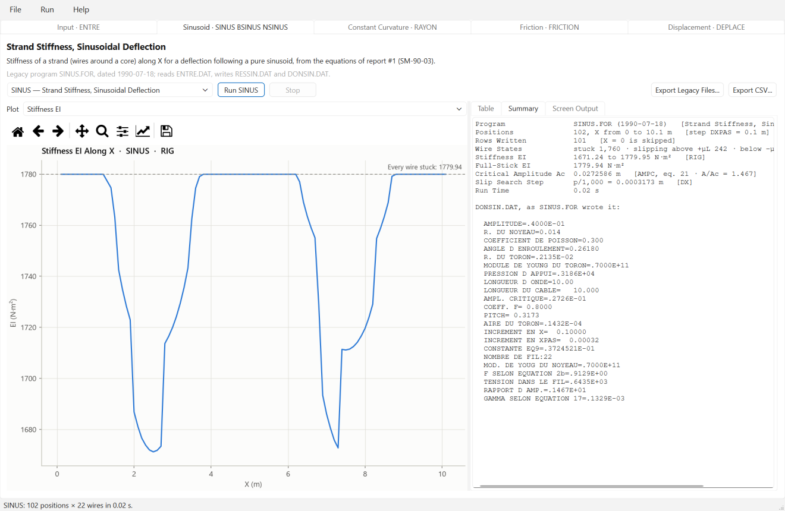

# Master Rebuild — user manual

Master Rebuild runs the seven Fortran programs of 1990 that computed the transverse stiffness
of a strand — wires wound on a core, sticking to it or slipping — under an imposed deflection.
The numbers are the ones the old programs printed; the plots, tables and file handling are new.

## Getting started

Launch it with `runApp.cmd` (or `master-rebuild` in the project's virtual environment). It
opens on the **Input** tab with the strand of the 1991 progress reports already filled in: 22
aluminium wires on a 13.53 mm core, 643.5 N per wire, a sinusoidal deflection of 0.04 m over
10 m. Go to the **Sinusoid** tab and press **Run SINUS** (or F5): at X = 2.5 m you get the
stiffness the 1991 report printed, 1671.24 N·m².

## The tabs

| Tab | Program(s) | Answers |
|---|---|---|
| Input · ENTRE | ENTRE | The fifteen values every program reads |
| Sinusoid | SINUS, BSINUS, NSINUS | Stiffness EI along X for Y = A sin(2πX/λ) |
| Constant Curvature | RAYON | Stiffness EI along X for a constant radius of curvature ρ |
| Friction | FRICTION | Friction each wire needs to stay stuck (equation 19) |
| Displacement | DEPLACE | Displacement of the core surface along each contact helix (equation 23) |

## The Input tab

The fields are ENTRE.EXE's fifteen questions, in SI units as the programs expected: metres,
pascals, newtons, radians. Hover over a field to read the question ENTRE asked. Next to each
field are its Fortran names (strand programs / cable programs) and a friendlier reading:
0.2618 rad shows as 15.0002°, 7e10 Pa as 70 GPa.

You can type numbers as Fortran accepted them — `7e10`, `0.7D+11` — or with a decimal comma.
A field that is not a number turns red and the programs will not run until it is fixed.
Values a program could not run on (a helix angle in degrees, 51 wires, a zero wavelength) are
explained in red under the form.

**What the Programs Derive** updates as you type: lay length p, contact force q, Gamma, the
critical amplitude Ac and radius ρc, and whether wires will slip (A/Ac above 1, or ρ/ρc below 1).
**ENTRE.DAT as It Will Be Written** shows the file exactly as ENTRE.EXE would have written it.

- **Open ENTRE.DAT…** reads a file the way the programs did: only columns 2–15 count, and a
  number written without a decimal point has its last eight digits read as decimals. Anything
  surprising of that kind is listed in red after opening.
- **Save ENTRE.DAT As…** writes the file the old programs can read, DOS line endings included.
- **Example** loads one of the two cases from the 1991 reports (also under File > Load Example).

Two things the old input file did that still apply:

- **One field, two meanings.** "Amplitude or Radius of Curvature" is the amplitude A for the
  sinusoid programs and the radius ρ for RAYON. RAYON also ignores the wavelength. If you run
  RAYON with an amplitude in that field, the status bar says so.
- **The step along X is CL/NPAS**, the strand length divided by the number of positions — not
  the span from start to end divided by anything. The hint next to Number of Positions shows it.

## Running a program

Choose the program (on the Sinusoid tab: SINUS, BSINUS or NSINUS), press **Run** or F5. Long
runs — NSINUS searches slip bounds ten times more finely — show a progress bar and can be
stopped with **Stop** (Shift+F5). If you change the inputs after a run, an orange note says the
shown result is out of date.

SINUS and BSINUS give the same numbers: BSINUS reads the wire fields as the properties of
strands around a core and writes different file names. NSINUS refines the slip bounds and lists,
for every wire at every position, where slipping starts and ends.

## Reading the results

**Plot** picks what to draw:

- Stiffness EI, the moments Mz, My, Mx and the forces Fx, Fy, Fz along X. The dashed line on the
  stiffness plot is the value with every wire stuck, (n/2)·E·a·Ra²·f·cos α.
- **Slip Map**: each wire at each position, stuck (gray) or slipping with the demand above +μL
  (red) or below −μL (blue).
- **Wire Elongation** and **Required Friction**: one wire highlighted (choose it with **Wire**),
  the others in gray. Required Friction marks ±μL.
- On the Displacement tab: the core displacement, and the two brackets of equation 23.

Hover over a curve to read the nearest value. The toolbar above the plot pans, zooms and saves
the figure.

On the right:

- **Table** — the result file's columns at full precision (hover a cell for every digit).
- **Summary** — what the run found, then the summary file the program wrote (DONSIN.DAT and so
  on), exactly as written.
- **Screen Output** — what the program printed on the DOS screen. Long listings stop after
  50 000 lines here; the exported `.OUT` file has them all.

## Exporting

- **Export Legacy Files…** (Ctrl+E) writes the program's own files — for SINUS, `RESSIN.DAT`
  and `DONSIN.DAT` — plus the `ENTRE.DAT` used and the screen output as `SINUS.OUT`, record for
  record as in 1990. The old programs refused to overwrite their files; the app asks first.
- **Export CSV…** writes the table with every digit, for a spreadsheet or a script.

## What you will see that the 1990 programs also did

- Stiffness programs skip X = 0 (the stiffness would divide by sin 0) and run once more at the
  first X at or past the end position; FRICTION and DEPLACE stop before it.
- Positions are added up step by step, so 0.1 added ten times is 0.9999999999999999 and the
  loop takes one more step.
- A value too wide for its column prints as `******` in the legacy files, and the optional
  leading zero goes when the column is full (`-.0087`). The table and CSV always have the value.
- The stiffness jumps where a wire starts or stops slipping: the 1990 model does not make the
  wire's deformation continuous at the slip bounds.

## When something goes wrong

Failures open a dialog with the whole explanation; the status bar holds a one-line summary.
"*PROGRAM* Did Not Run" lists every input it cannot use and why. The original sources are under
**Help > Legacy Fortran Sources**.
